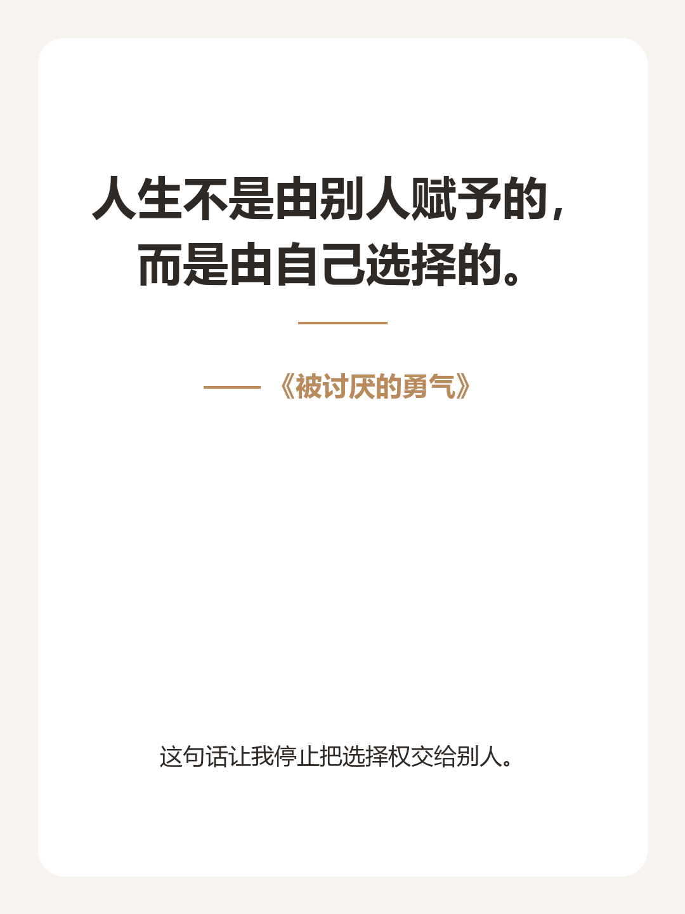

# 书摘卡片生成器

这是一个用 Python 和 Streamlit 制作的书摘卡片生成器。

你可以输入书名、好句和个人理解，选择喜欢的模板，自动生成适合小红书使用的 3:4 图片。

## 功能

- 输入好句、书名和个人理解
- 支持多套卡片配色模板
- 自动处理中文换行
- 在线预览图片
- 下载生成的 PNG 图片

## 本地运行

```bash
python -m pip install -r requirements.txt
streamlit run streamlit_app.py
```

浏览器打开：

```text
http://localhost:8501
```

## 项目结构

```text
book-card-generator/
├── card_generator.py
├── templates.json
├── streamlit_app.py
├── requirements.txt
└── README.md
```

## 示例


